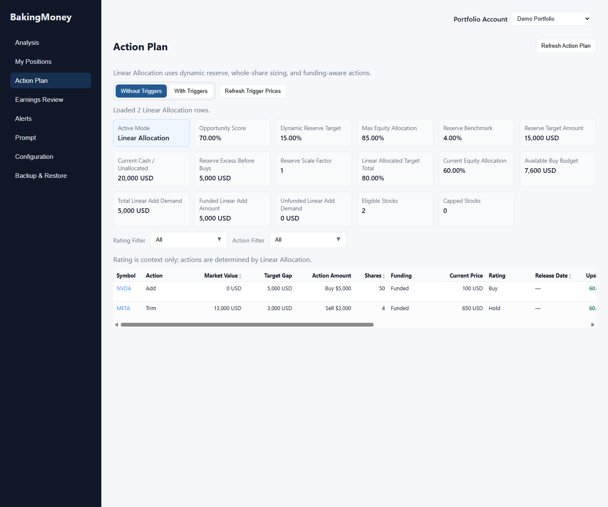
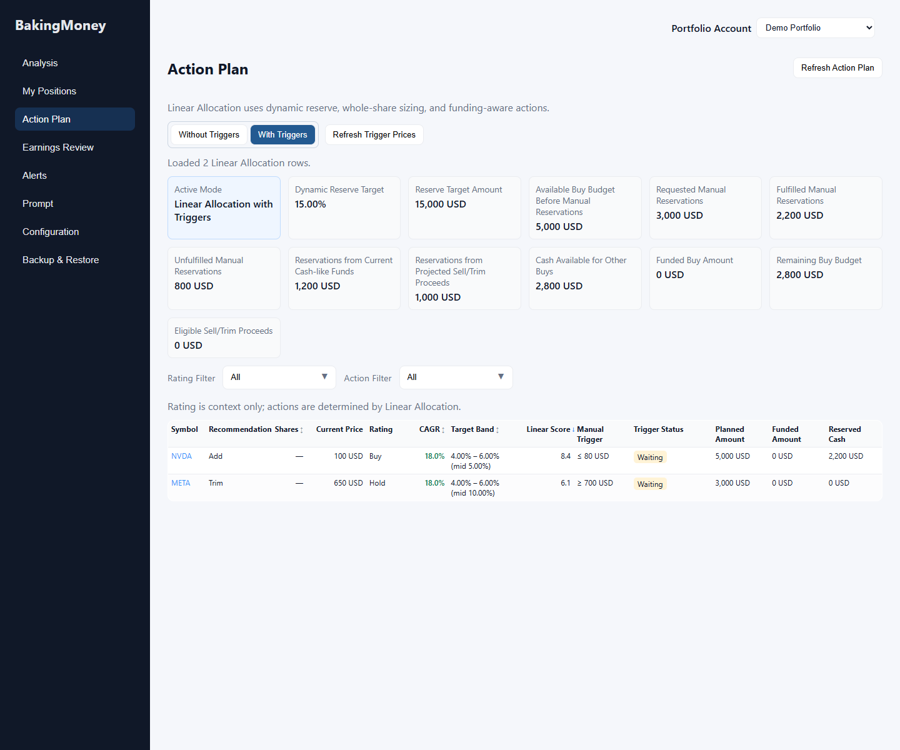
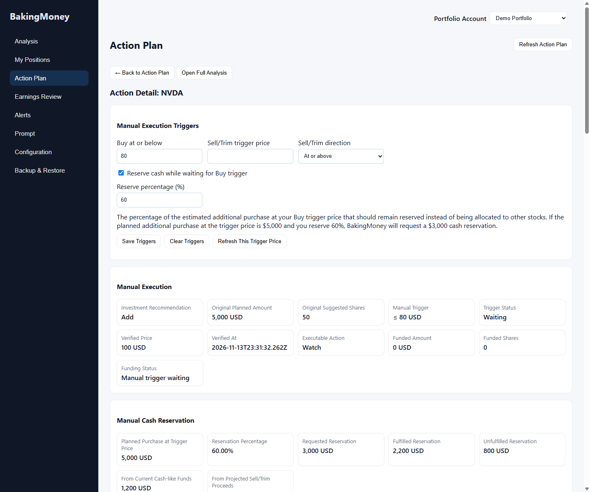

# Manual Execution Triggers

Manual triggers delay execution of an existing Linear Allocation recommendation. They do not change company ratings, allocation scores, target bands, or saved analysis prices. BakingMoney never places an order from this screen.

## Workflow

1. Open **Action Plan**. **Without Triggers** shows the existing funded plan. **With Triggers** shows the manual execution plan from the same Action Plan response. Switching modes makes no API request.
2. Open a symbol. Enter an optional **Buy at or below** price and an optional shared **Sell/Trim trigger price** with direction. The Sell/Trim setting applies to Sell, Strong Sell, Trim, and Strong Trim recommendations.
3. Enable **Reserve cash while waiting for Buy trigger** and choose 0–100% if desired. The requested amount is a planning earmark; it does not restrict IBKR cash. The editor retains this preference even while the current recommendation is Hold or Sell.
4. Select **Save Triggers** to write the complete preference object, or **Clear Triggers** to delete it. A successful save reloads the dual-mode plan once. A reload failure is reported separately from persistence success.
5. Select **Refresh Trigger Prices** to ask TWS for current bid and ask observations for applicable manual triggers. The detail editor also has **Refresh This Trigger Price**. Quote refresh is explicit; there is no polling or TWS request during Action Plan GET or mode switching.

The manual table keeps the original investment recommendation visible. Trigger status is separate from funded amount and whole shares. **Eligible, unfunded** means the price condition is satisfied but the trade has no funded whole shares. Guardrails remain visible. The manual summary separates Dynamic Reserve from requested, fulfilled, and unfulfilled manual reservations, including the portions backed by current cash-like funds and projected Sell/Trim proceeds.

## API

`GET /api/action-plan?execution_modes=both&account_id=...` returns the unchanged baseline `linear_action_plan` and `summary.linear_summary`, plus `manual_execution.linear_action_plan`, `manual_execution.summary`, and `manual_execution.price_verification`. Detail GET with `execution_modes=both` returns `action_detail` and `manual_execution_detail`.

Existing preference endpoints are `GET /api/manual-execution-triggers/{symbol}`, `PUT /api/manual-execution-triggers/{symbol}`, and `DELETE /api/manual-execution-triggers/{symbol}`. PUT replaces the complete object:

```json
{
  "buy_trigger_price": 80,
  "sell_trigger_price": 700,
  "sell_trigger_direction": "at_or_above",
  "reserve_enabled": true,
  "reserve_percentage": 60
}
```

`POST /api/manual-execution-quotes/refresh?account_id=...` accepts `{"symbols":["NVDA","META"]}`. It validates and deduplicates 1–25 symbols, checks that each has a saved analysis version, resolves the selected account, and returns one result per symbol. Statuses are `verified`, `confirmation_required`, `contract_unavailable`, `not_analyzed`, or `tws_unavailable`; verified results include bid, ask, and verification time. TWS connection failure returns HTTP 503 with per-symbol unavailable results. Partial market-data failures return HTTP 200 with mixed per-symbol statuses.

## Quote evidence and scope

The endpoint requests live market data mode for this explicit operation and restores the existing delayed mode afterward. Owned symbols use their account's TWS position contract when available. Unowned symbols use a uniquely qualified USD SMART stock contract. Contract qualification is batched, with per-symbol recovery only if the batch call fails. Ambiguous or mismatched contracts are rejected. The existing observation collector requires recent positive-size live bid and ask events for the same qualified contract, checks the ticker's current fields against those events, and rejects delayed, frozen, partial, and wrong-contract quotes. The endpoint cancels market subscriptions after the request.

Successful proof is held only in process memory under database path, portfolio account, and symbol. A failed refresh removes earlier proof for the requested symbol. The five-minute freshness check is enforced on every Action Plan calculation. The UI also stops displaying a cached quote as verified when its supplied expiry passes and asks for recalculation. The verified ask determines Buy eligibility and sizing; verified bid determines Sell/Trim eligibility. Owned positions retain their existing My Positions quote proof path; the newer valid proof wins if both paths have evidence. Neither explicit quote path writes analysis versions or portfolio positions.

## Screenshots

These screenshots use synthetic portfolio rows rendered in Chrome. They contain no user portfolio data or live TWS quote.







Regenerate with `node tools/capture_manual_execution_screenshots.js` on a machine with Chrome. The script uses a temporary browser profile and a local static server; it does not open the application database.

## Manual TWS checks

- Verify a live unowned Buy with ask below threshold becomes eligible, releases its reservation, and sizes whole shares at that ask.
- Verify an ask above threshold remains waiting; check the same for Sell/Trim using bid and both direction choices.
- Disconnect TWS and repeat refresh; confirm per-symbol unavailable feedback and no reuse of prior proof. Reconnect and repeat.
- Request a symbol without live permissions, and a symbol with delayed/frozen or one-sided data; confirm price confirmation is required.
- Switch between two managed accounts with the same symbol and distinct preferences; confirm proof and reservations do not cross accounts.
- Wait more than five minutes, refresh the Action Plan, and confirm the old quote no longer makes a trigger eligible.

The implementation does not track whether a threshold crossed between refreshes. Unowned contract qualification is currently limited to USD SMART stocks. A TWS subscription and live bid/ask permissions are required for verification.
