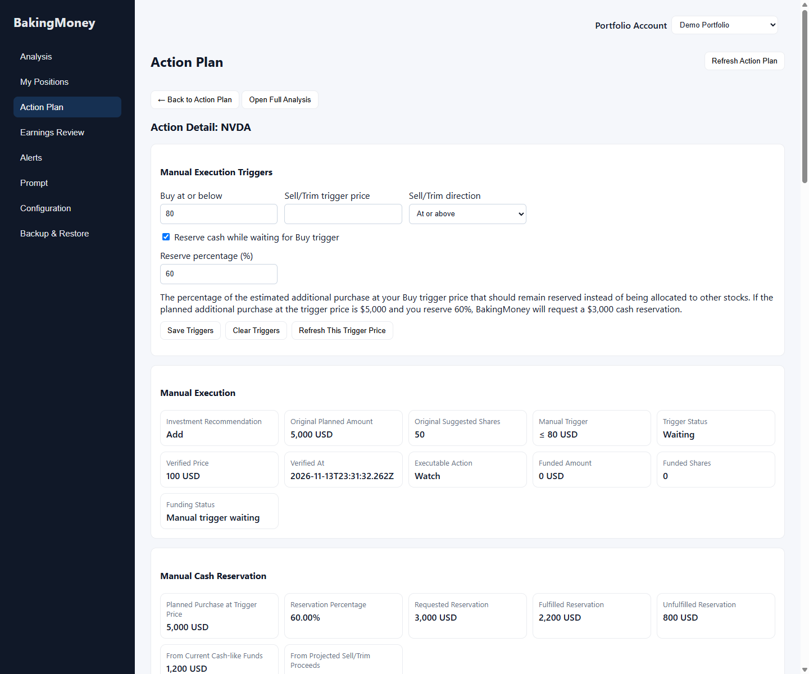

# Manual Execution Triggers

Manual triggers delay execution of an existing Linear Allocation recommendation. They do not change company ratings, allocation scores, target bands, or saved analysis prices. BakingMoney never places an order from this screen.

## Workflow

1. Open **Action Plan**. **Without Triggers** shows the existing funded plan. **With Triggers** shows the manual execution plan from the same Action Plan response. Switching modes makes no API request.
2. Open a symbol. Enter an optional **Buy at or below** price and an optional shared **Sell/Trim trigger price** with direction. The Sell/Trim setting applies to Sell, Strong Sell, Trim, and Strong Trim recommendations.
3. Enable **Reserve cash while waiting for Buy trigger** and choose 0–100% if desired. The requested amount is a planning earmark; it does not restrict IBKR cash. The editor retains this preference even while the current recommendation is Hold or Sell.
4. Select **Save Triggers** to write the complete preference object, or **Clear Triggers** to delete it. Only one Save or Clear request can be active for the same account, Action Plan or simulation, and symbol. Both mutation buttons are disabled while that request is pending, but the fields remain editable. A successful save reloads the dual-mode plan once. Edits made during the request remain visible and unsaved until the user explicitly saves again. A reload failure is reported separately from persistence success.
5. Select **Refresh Trigger Prices** to ask TWS for a newer usable market price for applicable manual triggers. The detail editor also has **Refresh This Trigger Price**. Quote refresh is explicit; there is no polling or TWS request during Action Plan GET or mode switching.

The manual table keeps the original investment recommendation visible. Trigger status is separate from funded amount and whole shares. **Eligible, unfunded** means the price condition is satisfied but the trade has no funded whole shares. Guardrails remain visible. The manual summary separates Dynamic Reserve from requested, fulfilled, and unfulfilled manual reservations, including the portions backed by current cash-like funds and projected Sell/Trim proceeds.

## API

`GET /api/action-plan?execution_modes=both&account_id=...` returns the unchanged baseline `linear_action_plan` and `summary.linear_summary`, plus `manual_execution.linear_action_plan`, `manual_execution.summary`, and `manual_execution.price_verification`. Detail GET with `execution_modes=both` returns `action_detail` and `manual_execution_detail`.

Existing preference endpoints are `GET /api/manual-execution-triggers/{symbol}`, `PUT /api/manual-execution-triggers/{symbol}`, and `DELETE /api/manual-execution-triggers/{symbol}`. PUT replaces the complete object:

```json
{
  "buy_trigger_price": 80,
  "sell_trigger_price": 700,
  "sell_trigger_direction": "at_or_above",
  "reserve_enabled": true,
  "reserve_percentage": 60
}
```

`POST /api/manual-execution-quotes/refresh?account_id=...` accepts `{"symbols":["NVDA","META"]}`. It validates and deduplicates 1–25 symbols, checks that each has a saved analysis version, resolves the selected account, and returns one result per symbol. A result reports a usable quote or explains why the refresh failed. TWS connection failure returns HTTP 503 with per-symbol feedback. Partial market-data failures return HTTP 200 with results for each requested symbol. An unsuccessful refresh leaves the last usable planning price available.

## Latest usable price

Both Action Plan workspaces select prices from the selected account's position market data and available contract-matched observations, including explicit quote refreshes saved in SQLite. Market observation time, retrieval time, and persistence time are separate metadata. Known timestamps are normalized to UTC. Request completion is recorded as retrieval time and is never promoted to an exchange observation time.

A usable observation's effective freshness time is its market observation time when known. Otherwise, retrieval time can act as a freshness proxy only when the current IBKR acquisition delivered the exact live or delayed value selected for the price. A selected Last requires a matching Last tick; a selected midpoint requires matching current-acquisition ticks for both final bid and ask values. Evidence is isolated by ticker instance, contract and feed class. A populated ticker, completed request, unrelated field tick, one new side combined with one cached side, or feed classification is not evidence by itself. Historical closes, cached prices, frozen snapshots, delayed-frozen snapshots, and unsupported observations receive no retrieval-time freshness proxy. Bid/ask observations use the older side's market timestamp when both sides form one coherent snapshot; BakingMoney never combines sides from different ticker instances or candidates.

The newest effective freshness time wins, whether that time came from the market or from evidenced streaming receipt. A real market timestamp wins an exact-time confidence tie. Source quality is then the deterministic fallback: live, delayed, frozen or closing, delayed-frozen, then cached market data. Persistence is storage state and does not erase the original feed class. A coherent two-sided quote breaks a remaining tie, followed by retrieval time as a deterministic final ordering. Resolution and observation persistence use this same ranking. Saved company analysis remains outside the market ordering as the final fallback. When all sources lack a positive finite price, the trigger shows **Price Unavailable**.

A two-sided observation supplies its midpoint as the reference when it has no separate market price. Buy triggers compare the ask and Sell/Trim triggers compare the bid. The trigger detail identifies the side and the time used. A single-price observation supplies the same value for display and evaluation. The price condition is **Eligible** or **Waiting** regardless of quote age. A cached, delayed, older, or unknown-time price may differ from the price currently available in the market.

Price displays say **market observed at** only when that timestamp is known. Retrieval-only quotes say **retrieved at**; otherwise the time is shown as unknown. Explicit refreshes collect market data only when requested. A position is owned for contract resolution only when its quantity is finite and nonzero; positive and negative quantities require the position's exact IBKR contract. Zero, negative zero, missing, invalid and non-finite quantities follow the unowned rules, so a historical cached contract cannot override a persisted qualified selection. For an unowned symbol, the account-and-symbol selection is written only after exactly one compatible IBKR stock contract qualifies successfully; quote failure after qualification does not discard that identity, while failed or ambiguous qualification does not replace the previous selection. A selected contract never borrows another contract's price.

Without a persisted selection, one metadata-compatible stock candidate may remain usable, but its identity is labeled **inferred, not verified**. Available security-type and currency metadata must agree. Multiple known contract identities are ambiguous and fall back safely instead of selecting the newest quote; incompatible candidates also fall back. An unknown-only legacy observation remains available with an explicit identity warning and is never matched to an owned contract. Usable observations and qualified selections survive restart and are isolated by portfolio account and contract. Refreshing market data leaves research inputs intact.

SQLite observations and position-cache rows store nullable `market_observed_at`, `retrieved_at`, `persisted_at`, and acquisition provenance. Observations use the composite key `(account_id, symbol, contract_key)`, so a qualified contract transition preserves both identities instead of overwriting the earlier one. `action_plan_contract_selections` stores the latest successfully qualified stock identity by `(account_id, symbol)` with security type, currency, and qualification time. Database initialization transactionally copies the original symbol-keyed observation table into the contract-keyed schema, verifies the row count before replacing it, and creates the selection table when an older database or restored backup lacks it. A legacy `price_last_successful_at` remains readable as retrieval metadata only when neither explicit retrieval metadata nor an explicit market time exists; migration never reinterprets it as a confirmed exchange timestamp.

## Screenshots

These screenshots use synthetic portfolio rows rendered in Chrome. They contain no user portfolio data or live TWS quote.




Regenerate with `node tools/capture_manual_execution_screenshots.js` on a machine with Chrome. The script uses a temporary browser profile and a local static server; it does not open the application database.

## Manual TWS checks

- Verify a live unowned Buy with ask below threshold becomes eligible, releases its reservation, and sizes whole shares at that ask.
- Verify an ask above threshold remains waiting; check the same for Sell/Trim using bid and both direction choices.
- Disconnect TWS and repeat the refresh. Confirm the failure feedback and verify that an earlier usable price still evaluates the trigger.
- Request a symbol with delayed data. Check the source and timestamp used for the trigger.
- Switch between two accounts with the same symbol and distinct preferences. Check each account's price and reservations.
- Reopen the application after more than five minutes. Verify that a last-known usable price can still satisfy a trigger.

The plan evaluates available observations when calculated. It does not track intraday threshold crossings between observations.
